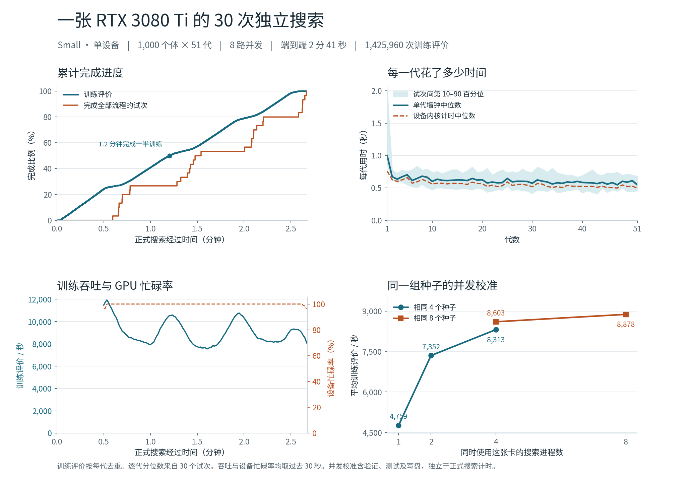

# 用 NVIDIA CUDA 或摩尔线程 MUSA 训练双树 MTGP

在 Small 单移动设备场景，NVIDIA RTX 3080 Ti 与摩尔线程 MTT S4000 分别跑完了 **1,000 个体 × 51 代 × 30 次独立演化**。两端生成的 30 份演化历史和验证 JSON、30 份测试 CSV **逐字节一致**，覆盖 1,530 代与 900 条测试记录。CUDA 端到端用时 **2 分 40.53 秒**，MUSA 用时 **17 分 25.33 秒**。墙钟从进程启动到全部训练、验证、测试、写盘和进程退出。[逐试次 SHA-256](benchmark/cross-device.csv) · [两机时间比](benchmark/cross-device.json)

| 设备与后端 | 每组线程 | 同卡进程 | 30 次总墙钟（秒） | 去重训练评价 / 秒 | 平均设备忙碌率 |
| --- | ---: | ---: | ---: | ---: | ---: |
| RTX 3080 Ti · CUDA 12.8 | 32 | 8 | 160.53 | 8,883 | 98.17% |
| MTT S4000 · MUSA 5.2 | 64 | 2 | 1,045.33 | 1,364 | 98.83% |

以各自主机实测选出的配置运行，RTX 的整机吞吐为 S4000 的 **6.51 倍**。RTX 的 30 次计时来自本次上游集成，S4000 的 30 次计时沿用先前按表达式文本去重的主机适配器。本次集成直接以紧凑双树为键，写报告时生成表达式文本。两主机 CPU 配额分别为 12 核和 15 核，Python 版本也不同。单独测量的宽度与并发校准分别合计 183.68 秒和 505.19 秒。RTX 上四个相同试次以 1、2、4 路运行分别用时 39.72、25.71、22.74 秒，再用八个相同试次比较 4 和 8 路，分别为 44.11 和 42.74 秒。S4000 上同四个试次以 1、2、4 路运行分别为 150.82、135.19、135.22 秒。[CUDA 校准](benchmark/rtx-3080-ti/scaling.csv) · [MUSA 校准](benchmark/s4000/scaling.csv)

补充对照使用同一提交的正常训练入口，固定一个进程、每组 32 线程和第 26 个完整试次。CUDA 用时 11.98 秒，MUSA 用时 59.67 秒，两机墙钟比为 4.98。两份 JSON 和 CSV 的摘要仍逐一相等。[CUDA 单试次](benchmark/rtx-3080-ti/single-trial.json) · [MUSA 单试次](benchmark/s4000/single-trial.json)

两端均实际评价 1,425,960 次去重训练规则、4,536 次验证候选和 900 次测试。RTX 上累计完成 25%、50%、75% 和全部训练评价的用时为 31.45、72.14、112.24 和 155.82 秒，S4000 上对应为 239.57、507.75、771.28 和 1,031.68 秒。设备忙碌率来自每秒一次的驱动采样。[CUDA 逐代数据](benchmark/rtx-3080-ti/generations.csv) · [MUSA 逐代数据](benchmark/s4000/generations.csv)



可分别查看 [RTX 3080 Ti 矢量曲线](benchmark/rtx-3080-ti/timing-curves.pdf) 和 [MTT S4000 曲线](benchmark/s4000/timing-curves.png)。

## 搜索与选优

Small/1 场景含一台移动设备、20 台边缘服务器和 20 台云服务器，每条流依次释放 10 条热身工作流和 20 条测量工作流。每对规则占一个工作组。静态输入按任务和资源打包，工作组各自维护事件堆、资源队列和已完成工作量。组内线程并行比较当前可选的派发目的地或可开工任务。两种后端共用选择循环、矩阵布局和设备事件内核。CUDA 用硬件双精度最近偶数舍入除法，MUSA 用整数尾数运算实现同样的舍入，两者均保留 B04 的受保护零除和平局顺序。主机用同一种子繁殖紧凑的双树，并在评价当前流时准备下一份输入。GPU 负责训练、验证和测试的完整离散事件仿真。

30 个演化种子为 50001–50030，每代按 B04 的原公式轮换训练流。每次演化用 80000–80002 三条验证流选出规则。按上游表 VII 的统计口径，先对每个试次的 30 条测试流取均值，再对 30 次独立演化取均值与样本标准差，结果为 **2,446.28 ± 45.46 个模拟秒**。再按同一验证指标选出的第 26 个试次，在 90000–90029 这 30 条共同测试流上的平均模拟工期为 **2,373.85 秒**。预先冻结的首试次规则为 **2,446.51 秒**，平均缩短 **2.97%**，24/30 个种子工期更短。按种子配对重采样的平均节省量为 72.66 秒，95% 百分位区间为 43.63–102.09 秒。该比较的基线是同预算的首试次规则。900 行测试记录共用 30 个环境种子。[排序树和路由树](benchmark/s4000/winner.json) · [逐种子工期](benchmark/s4000/winner-tests.csv)

## 构建和核对

以下 Linux 命令从仓库根目录执行。两台主机均使用 DEAP 1.4.4、NumPy 2.2.6 和 moocore 0.3.2。RTX 3080 Ti 使用 Python 3.12.3、CUDA Toolkit 12.8 和驱动 580.76.05。MTT S4000 使用 Python 3.10.8 和 MUSA 5.2。DAX 与 Python 模块均来自本仓库的 B04 分发包。

```sh
python3 -m venv .venv
. .venv/bin/activate
python -m pip install 'deap==1.4.4' 'numpy==2.2.6' 'moocore==0.3.2'
python -m zipfile -e 'python实现/fogsim-0.4.0-B04.zip' .venv/fogsim-study
study_pkg="$PWD/.venv/fogsim-study/fogsim-0.4.0"
export PYTHONPATH="$study_pkg/src:$PWD/reproduction"
export OPENBLAS_NUM_THREADS=1 OMP_NUM_THREADS=1 MKL_NUM_THREADS=1
```

**NVIDIA CUDA。** 以下目标为 RTX 3080 Ti 的计算能力 8.6，可按实际显卡调整 `-arch`。两种编译命令都关闭乘加融合，以保留 B04 的运算顺序。

```sh
gpu_engine=cuda
export FOGSIM_CUDA_LIBRARY="$PWD/.venv/fogsim-study/libfogsim_cuda.so"
/usr/local/cuda/bin/nvcc -O2 -std=c++17 --fmad=false -arch=sm_86 -Xcompiler=-fPIC -shared \
  reproduction/gpu/fitness.cu -o "$FOGSIM_CUDA_LIBRARY"
```

**摩尔线程 MUSA。**

```sh
gpu_engine=musa
export FOGSIM_MUSA_LIBRARY="$PWD/.venv/fogsim-study/libfogsim_musa.so"
/usr/local/musa/bin/mcc -O2 -std=c++17 --fmad=false -fPIC -shared reproduction/gpu/fitness.mu \
  -L/usr/local/musa/lib -Wl,-rpath,/usr/local/musa/lib -lmusart -o "$FOGSIM_MUSA_LIBRARY"
```

编译选定的后端后，重建演化种子 50001 的初代并运行一次 GPU 评价，将全部 1,000 个结果按原顺序与 B04 Python 已保存的分数逐值比较。[Python 对照](fixtures/first-generation.csv)

```sh
python -m gpu.calibrate --engine "$gpu_engine" --dax "$study_pkg/dax" --check-only
```

## 运行搜索

日常训练沿用 `run_mtgp.py` 的参数、输出命名和 JSON/CSV 格式。默认引擎为 Python。下例使用上表实测的并发数与线程组宽度。输出目录使用新路径。

```sh
case "$gpu_engine" in
  cuda) gpu_lanes=32; gpu_workers=8 ;;
  musa) gpu_lanes=64; gpu_workers=2 ;;
esac
python reproduction/run_mtgp.py --engine "$gpu_engine" --profile paper --scales small --devices 1 \
  --workers "$gpu_workers" --lanes "$gpu_lanes" --dax "$study_pkg/dax" --out ".venv/small-1-$gpu_engine"
```

需要复测设备宽度、并发及各阶段墙钟时使用下面的基准入口。宽度校准固定同一代，先暖机，再以不同次序各计三遍，并发校准固定同一组完整演化种子。相邻档吞吐提高超过 3% 时继续扩展，随后从头实测全部 30 个试次。CUDA 通过 `nvidia-smi`、MUSA 通过 `mthreads-gmi` 采样设备 0，适用于默认设备 0 上的单卡测量。

```sh
gpu_run=".venv/$gpu_engine-timing"
python -m gpu.calibrate --engine "$gpu_engine" --dax "$study_pkg/dax" --out "$gpu_run"
python -m gpu.campaign --engine "$gpu_engine" --dax "$study_pkg/dax" --out "$gpu_run"
python -m gpu.summarize "$gpu_run"
```

## 从已有数据重建曲线

每个原始包包含各档并发校准和 30 个正式试次的演化历史、验证、测试、逐批计时、文件摘要与每秒设备采样。汇总与跨设备校验只用 Python 标准库，绘图还需要 Matplotlib 及 Noto Sans CJK SC，可用 `--font` 指定中文字体。两端均实测了九场景各一个短试次，并逐个核对原 B04 的演化记录和 270 条测试行。[CUDA 原始包](benchmark/rtx-3080-ti/raw-results.zip) · [MUSA 原始包](benchmark/s4000/raw-results.zip) · [CUDA 短试次核验](benchmark/rtx-3080-ti/upstream-pilot-parity.csv)

```sh
python -m zipfile -e reproduction/gpu/benchmark/s4000/raw-results.zip .venv/musa-archive
python -m zipfile -e reproduction/gpu/benchmark/rtx-3080-ti/raw-results.zip .venv/cuda-archive
PYTHONPATH=reproduction python -m gpu.summarize .venv/musa-archive
PYTHONPATH=reproduction python -m gpu.summarize .venv/cuda-archive
PYTHONPATH=reproduction python -m gpu.compare .venv/musa-archive .venv/cuda-archive --out .venv/comparison
python -m pip install 'matplotlib==3.10.9'
PYTHONPATH=reproduction python -m gpu.plot .venv/cuda-archive
PYTHONPATH=reproduction python -m gpu.plot .venv/musa-archive
```
